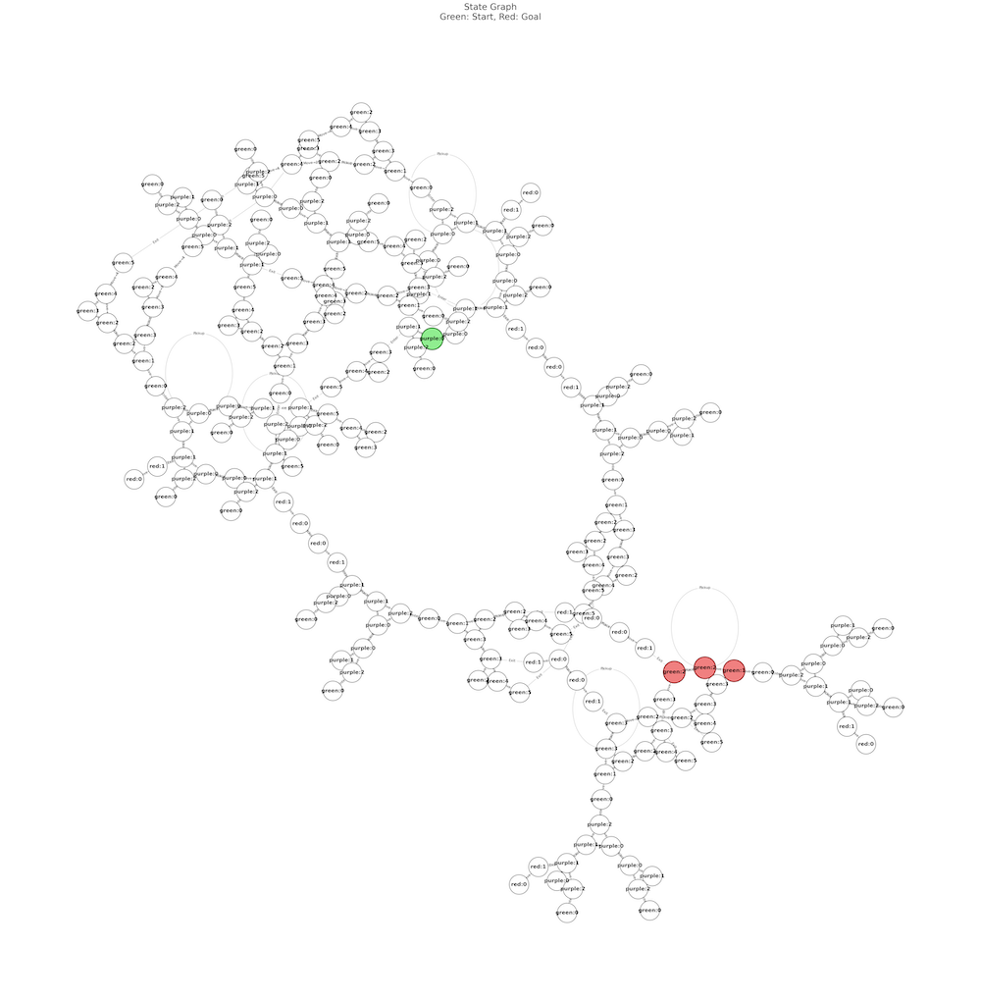

# Cocoon solver

A tool that solves tricky puzzles in the game [Cocoon](https://store.steampowered.com/app/1497440/COCOON/) for you. I consulted with a lawyer and they said that using this tool doesn't count as cheating.

The tool converts Cocoon puzzles to a state machine graph and then uses breadth-first search to solve them:



## Usage

Before the tool can solve a puzzle, you need to input the puzzle into the tool. This means adding the puzzle's layout and writing a function that checks whether the solver has reached a goal state. For example:

```python
def puzzle_49() -> tuple[World, State]:
    pg = nx.Graph()
    pg.add_node(0, node_type="ball_stand")
    pg.add_node(1, node_type="ball_stand")
    pg.add_node(2, node_type="exit")
    pg.add_node(3, node_type="vine", is_vine=True)
    pg.add_node(4, node_type="exit")
    pg.add_edges_from([(0, 1), (0, 2), (0, 3), (1, 2), (1, 3), (2, 3), (3, 4)])

    gg = nx.Graph()
    gg.add_node(0, node_type="ball_stand")
    gg.add_node(1, node_type="exit")
    gg.add_edges_from([(0, 1)])

    rg = nx.Graph()
    rg.add_node(0, node_type="ball_stand")
    rg.add_node(1, node_type="exit")
    rg.add_edges_from([(0, 1)])

    ow = nx.Graph()
    ow.add_node(0, node_type="ball_stand")
    ow.add_node(1, node_type="ball_stand")
    ow.add_node(2, node_type="pool")
    ow.add_edges_from([(0, 1), (0, 2), (1, 2)])

    world = World({"green": gg, "red": rg, "purple": pg, "overworld": ow})
    state = State(
        ball_positions={
            "red": Position(inside_ball="purple", node=0),
            "green": Position(inside_ball="purple", node=1),
            "purple": Position(inside_ball="overworld", node=2),
        },
        ball_last_exit_positions={
            "red": Position(inside_ball="red", node=1),
            "green": Position(inside_ball="green", node=1),
            "purple": Position(inside_ball="purple", node=2),
        },
        player_position=Position(inside_ball="purple", node=0),
        fairy_created=False,
    )
    return (world, state)

def is_success_49(state: State) -> bool:
    return state.player_position == Position(
        inside_ball="purple", node=4
    ) and state.ball_position("red") == Position(inside_ball="purple", node=4)


def get_puzzle_registry() -> Dict[int, PuzzleInfo]:
    return {
        49: PuzzleInfo(
            description="Basic puzzle with balls and vines",
            generator=puzzle_49,
            success_checker=is_success_49,
        ),
        # ...etc...
    }
```

See the code for more examples.

For puzzles where the tool already implements all of the necessary game logic, this shouldn't be too hard. However, since the tool only implements a subset of the game's logic, you may need to add new features (or improve existing ones) in order to make new puzzles work. Currently the tool has puzzles 49, 50, 51, and 92 programmed into it.

Once you've added your new puzzle this, run the tool like so:

```bash
# To solve a puzzle:
python main.py solve 92

# To solve a puzzle and generate a state machine graph as a png:
python main.py graph 51
```

## Contributing

You should probably just play the game properly, but I'd still love contributions of new levels and game logic!